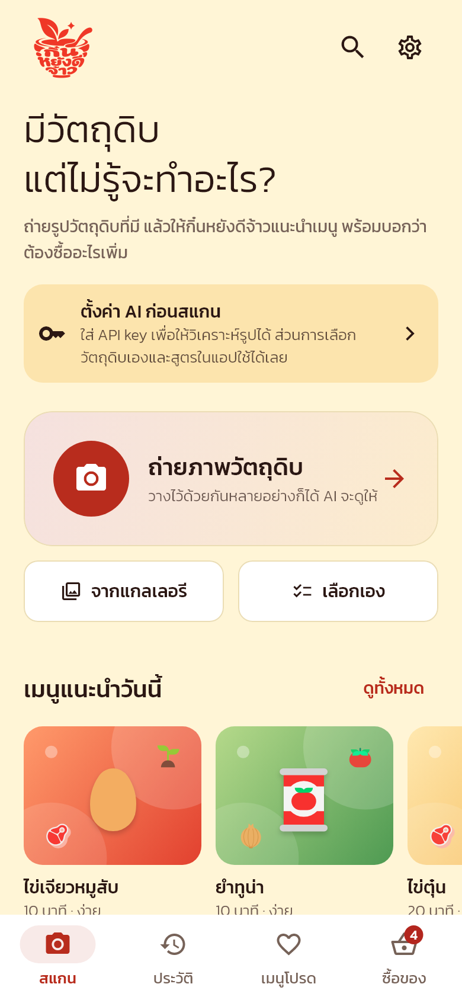
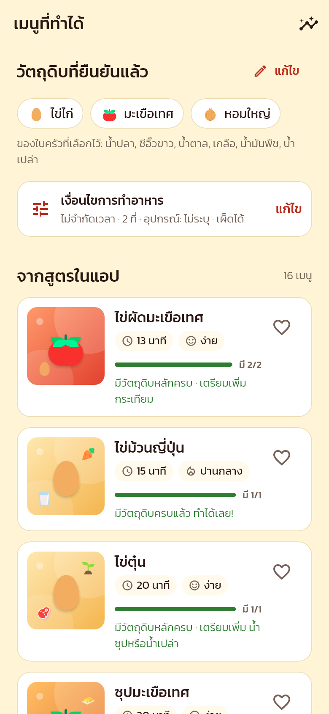
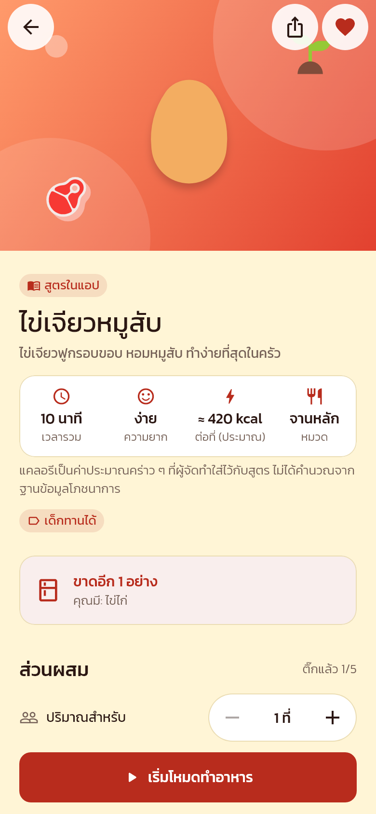
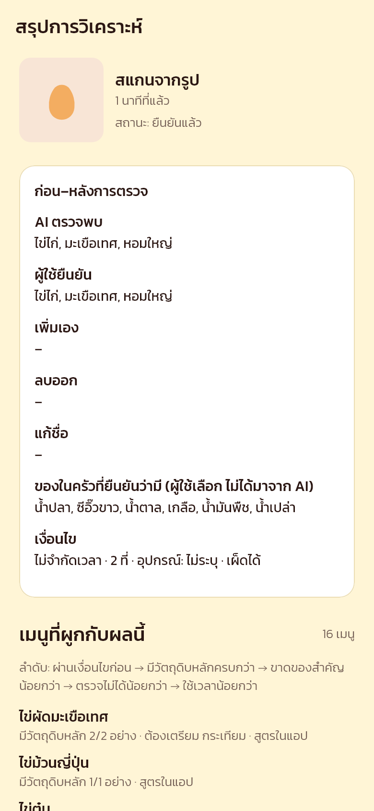
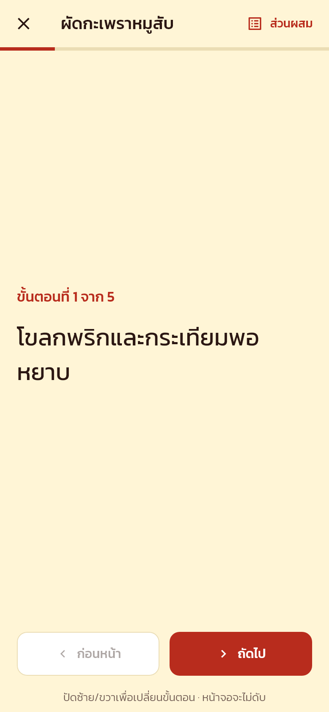
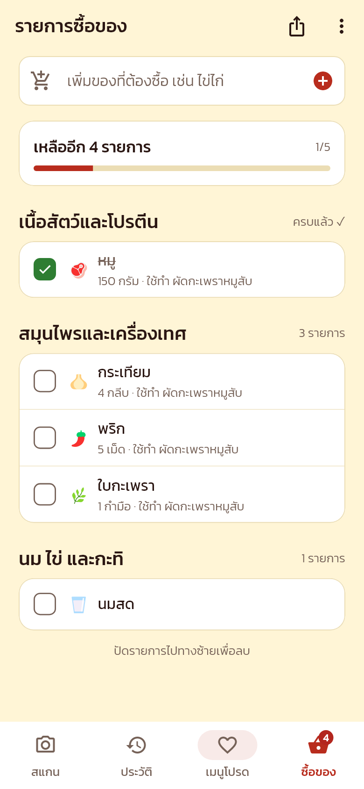
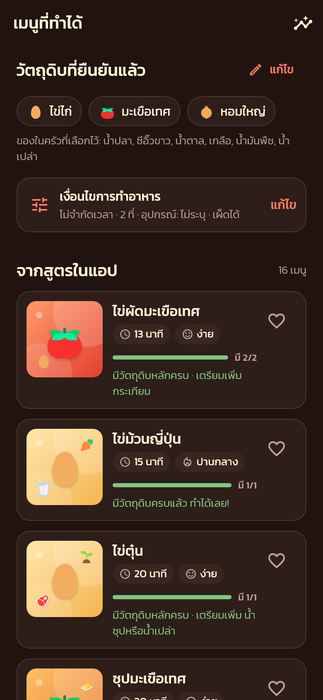
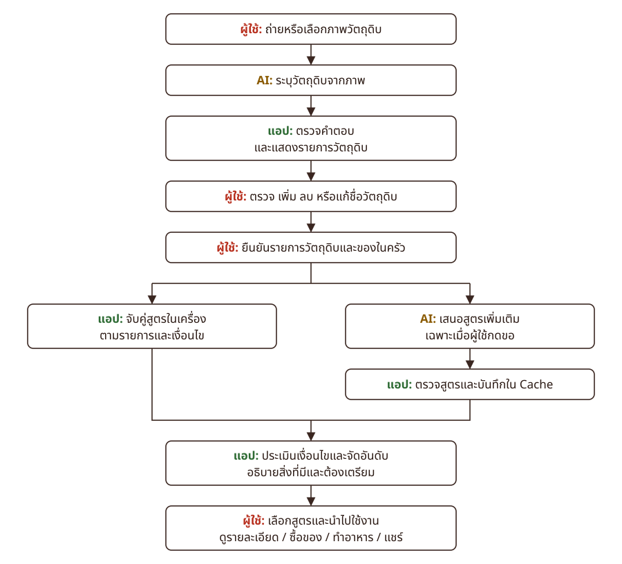

<div align="center">


# กิ๋นหยังดีจ้าว

**KinYangDeeChao** — *จากวัตถุดิบที่มี สู่เมนูที่ทำได้*

แอป Android ที่ช่วยคิดว่า "วันนี้กินอะไรดี" จากวัตถุดิบที่มีอยู่ในครัว

[](https://flutter.dev)
[](https://dart.dev)
[](#เริ่มต้นใช้งาน)
[](LICENSE)

[ฟีเจอร์](#ฟีเจอร์เด่น) · [ภาพหน้าจอ](#ภาพหน้าจอ) · [เริ่มต้นใช้งาน](#เริ่มต้นใช้งาน) · [ตั้งค่า AI](#ตั้งค่า-ai) · [เอกสาร](#เอกสารเพิ่มเติม)

</div>

---

## เกี่ยวกับโปรเจกต์

หลายคนมีวัตถุดิบเหลืออยู่ในตู้เย็นแต่นึกไม่ออกว่าจะทำอะไร **กิ๋นหยังดีจ้าว** ("กินอะไรดีจ๊ะ" ในภาษาเหนือ) ช่วยได้ตั้งแต่ถ่ายรูปวัตถุดิบ
ให้ AI ช่วยระบุ ให้ผู้ใช้ตรวจและยืนยัน แล้วแนะนำเมนูจาก **สูตรในแอป 65 เมนู** (ไทย เหนือ อีสาน และเมนูง่าย ๆ สำหรับนักศึกษา)
ตามเงื่อนไขที่ผู้ใช้เลือก พร้อมบอกว่ามีวัตถุดิบอะไรครบ ขาดอะไร และทำไมถึงแนะนำเมนูนี้

> แอปไม่ได้ฝึกโมเดล AI เอง แต่เรียกใช้โมเดลของผู้ให้บริการผ่าน API แล้วตรวจผลในแอปทุกครั้ง ผล AI จึงเป็นเพียง "ฉบับร่าง" ที่ผู้ใช้ต้องยืนยันก่อนเสมอ

## ภาพหน้าจอ

<table>
  <tr>
    <td align="center"><br><sub><b>สแกน</b> · ถ่ายรูป เลือกจากแกลเลอรี หรือเลือกเอง</sub></td>
    <td align="center"><br><sub><b>เมนูที่ทำได้</b> · จัดอันดับตามความครบของวัตถุดิบ</sub></td>
    <td align="center"><br><sub><b>รายละเอียดสูตร</b> · ปรับจำนวนที่และดูของที่ขาด</sub></td>
  </tr>
  <tr>
    <td align="center"><br><sub><b>สรุปการวิเคราะห์</b> · ก่อน–หลังการตรวจและลำดับการจัดอันดับ</sub></td>
    <td align="center"><br><sub><b>โหมดทำอาหาร</b> · ทีละขั้นตอน หน้าจอไม่ดับ</sub></td>
    <td align="center"><br><sub><b>รายการซื้อของ</b> · จัดกลุ่มตามหมวดอัตโนมัติ</sub></td>
  </tr>
</table>

<details>
<summary>โหมดมืด</summary>
<br>
<p align="center"></p>
</details>

## ฟีเจอร์เด่น

### สแกนและยืนยันวัตถุดิบ
- **ถ่ายภาพหรือเลือกจากแกลเลอรี** ให้ AI ระบุวัตถุดิบ หรือ **เลือกเองโดยไม่ต้องใช้ AI**
- **ผู้ใช้ตรวจก่อนเสมอ** แก้ชื่อ ลบ หรือเพิ่มรายการได้ (ฐานข้อมูลวัตถุดิบ 70 ชนิด หรือพิมพ์เอง) แอปเก็บผล AI เดิมไว้เทียบ และกู้ฉบับร่างคืนได้ถ้าแอปถูกปิดกลางคัน
- **เลือกของพื้นฐานในครัว** (น้ำปลา ซีอิ๊ว ฯลฯ) แยกจากวัตถุดิบในรูป

### แนะนำเมนูพร้อมเหตุผล
- **เงื่อนไขการทำอาหาร** เลือกเวลา (≤15/≤30 นาที) จำนวนที่ อุปกรณ์ที่มี (หรือไม่มีเตา) และไม่เผ็ด
- **จับคู่แบบตรงทั้งคำ** รองรับชื่อพ้อง เช่น "หมูสับ" = หมู และไม่สับสน ปลา กับ น้ำปลา หรือ ไข่ไก่ กับ ไข่เค็ม
- **อธิบายว่าทำไมแนะนำ** เช่น "มีวัตถุดิบหลัก 2/2 อย่าง" ซึ่งหมายถึงความครบของวัตถุดิบ ไม่ใช่ความมั่นใจของ AI พร้อมบอกว่าขาดอะไรและต้องเตรียมอะไร
- **ให้ AI คิดเมนูเพิ่ม** เมื่อผู้ใช้กดเท่านั้น แอปตรวจทุกสูตรก่อนแสดง ติดป้าย "สูตรจาก AI" และบันทึกผลไว้ดูซ้ำแบบออฟไลน์ได้
- **สรุปการวิเคราะห์และโหมดสาธิต** แสดงขั้นตอนของ AI แอป และผู้ใช้ รวมถึงบันทึกการเรียก AI ที่ไม่มีข้อมูลลับ

### ทำอาหารและซื้อของ
- **รายละเอียดสูตร** มีภาพปกที่สร้างด้วยโค้ด ปรับจำนวนที่แล้วปริมาณคำนวณตาม และติ๊กส่วนผสมกับขั้นตอนได้
- **โหมดทำอาหาร** ทีละขั้นแบบเต็มจอ ตัวอักษรใหญ่ หน้าจอไม่ดับ ปัดเพื่อเปลี่ยนขั้นตอนได้
- **รายการซื้อของ** เพิ่มของที่ขาดได้ในแตะเดียว กันรายการซ้ำ รวมปริมาณที่หน่วยเดียวกัน และแชร์เป็นข้อความได้
- **แชร์สูตร** เป็นข้อความหรือรูปการ์ดสูตร ผ่านเมนูแชร์ของ Android (เช่น LINE)

### ใช้งานทั่วไป
- ค้นหาและกรองสูตรทั้งหมด, ประวัติการสแกน, เมนูโปรด (ใช้แบบออฟไลน์ได้)
- โหมดมืด, ภาษาไทยทั้งระบบ, รองรับการขยายตัวอักษรบนจอเล็ก
- Onboarding ที่ใส่ API key ได้ (ข้ามได้) และหน้าตั้งค่าที่ทดสอบการเชื่อมต่อ AI ได้จริง

## การทำงาน

<p align="center">
  <picture>
    <source media="(prefers-color-scheme: dark)" srcset="docs/images/system-flow-dark.svg">
    
  </picture>
</p>

<p align="center"><sub>นอกจากถ่ายภาพ ผู้ใช้ยังเลือกวัตถุดิบเองได้โดยไม่ต้องผ่านขั้นตอน AI</sub></p>

รายละเอียดว่าส่วนไหนใช้ AI และส่วนไหนแอปตรวจเอง ดูได้ใน [docs/AI_FLOW.md](docs/AI_FLOW.md)

## เทคโนโลยีที่ใช้

| ส่วน | เทคโนโลยี |
|---|---|
| Framework | [Flutter](https://flutter.dev) 3.44+ / Dart 3.12+ (Material 3) |
| State management | `ChangeNotifier` + `InheritedWidget` (ไม่ใช้แพ็กเกจภายนอก) |
| เรียก AI | [`dio`](https://pub.dev/packages/dio) ผ่าน API แบบ OpenAI-compatible (`/chat/completions`) |
| เก็บข้อมูลในเครื่อง | [`shared_preferences`](https://pub.dev/packages/shared_preferences), [`flutter_secure_storage`](https://pub.dev/packages/flutter_secure_storage) (Android Keystore), [`path_provider`](https://pub.dev/packages/path_provider) |
| กล้องและแชร์ | [`image_picker`](https://pub.dev/packages/image_picker), [`share_plus`](https://pub.dev/packages/share_plus) |
| อื่น ๆ | [`wakelock_plus`](https://pub.dev/packages/wakelock_plus), [`package_info_plus`](https://pub.dev/packages/package_info_plus), [`uuid`](https://pub.dev/packages/uuid), [`flutter_native_splash`](https://pub.dev/packages/flutter_native_splash) |
| ฟอนต์ | [Kanit](https://github.com/cadsondemak/kanit) (SIL OFL 1.1) |

## เริ่มต้นใช้งาน

### สิ่งที่ต้องมี

- [Flutter SDK](https://docs.flutter.dev/get-started/install) 3.44 ขึ้นไป (มาพร้อม Dart 3.12+)
- JDK 17 และ Android SDK (ติดตั้งผ่าน Android Studio ได้)
- มือถือ Android หรือ Android Emulator

### ติดตั้งและรัน

```bash
git clone https://github.com/Atiwat-Bowornkit/kin-yang-dee-chao.git
cd kin-yang-dee-chao
flutter pub get
flutter run
```

### Build APK

```bash
flutter build apk --release
```

ไฟล์ที่ได้อยู่ที่ `build/app/outputs/flutter-apk/app-release.apk` (package name: `app.kinyangdeechao`)

> release APK ยังเซ็นด้วย debug key จึงติดตั้งและเดโมได้ แต่ยังอัปโหลดขึ้น Google Play ไม่ได้ ถ้าจะเผยแพร่ต้องตั้งค่า signing ของตัวเองใน `android/app/build.gradle.kts`

## ตั้งค่า AI

ฟีเจอร์ที่ไม่ใช้ AI (เลือกวัตถุดิบเอง สูตรในแอป ประวัติ เมนูโปรด และรายการซื้อของ) ใช้ได้ทันทีโดยไม่ต้องตั้งค่าอะไร
ส่วนการสแกนรูปและการขอเมนูจาก AI ต้องมี API key ของบริการที่รองรับ **OpenAI-compatible API**

**วิธีที่ 1: ตั้งค่าในแอป (แนะนำ)** ไปที่ **ตั้งค่า › การเชื่อมต่อ AI** แล้วใส่ API key กด **ทดสอบการเชื่อมต่อ** และเปลี่ยน Base URL หรือโมเดลได้ในส่วน "ตั้งค่าขั้นสูง"

**วิธีที่ 2: ฝังค่าเริ่มต้นตอน build (สำหรับนักพัฒนา)** แอปจะใช้ค่านี้เมื่อผู้ใช้ยังไม่ได้ใส่ key เอง

```bash
cp dart_defines.example.json dart_defines.json   # แล้วแก้ YOUR_KEY เป็น key จริง
flutter run --dart-define-from-file=dart_defines.json
```

| ตัวแปร | ค่าเริ่มต้น | คำอธิบาย |
|---|---|---|
| `AI_API_KEY` | *(ว่าง)* | API key ของผู้ให้บริการ |
| `AI_BASE_URL` | `https://gen.ai.kku.ac.th/upacth/api/v1` | Base URL ของ API (ต้องเป็น https) |
| `AI_MODEL` | `gemini-3.1-pro-preview` | ชื่อโมเดลที่รองรับการอ่านรูปภาพ |

> - `dart_defines.json` อยู่ใน `.gitignore` แล้ว **ห้าม commit ไฟล์นี้**
> - key ที่ฝังด้วย `dart-define` สามารถถูกดึงออกจากไฟล์ APK ได้ จึงไม่ควรใช้ key จริงกับ APK ที่แจกจ่ายสาธารณะ
> - ค่าเริ่มต้นของ Base URL ชี้ไปที่บริการ GenAI ของมหาวิทยาลัยซึ่งต้องใช้ key ของบริการนั้น ถ้าใช้ผู้ให้บริการอื่นให้เปลี่ยน Base URL และโมเดลตามผู้ให้บริการ

## โครงสร้างโปรเจกต์

```text
lib/
├── main.dart, app.dart   จุดเริ่มต้นของแอป สร้าง controller และบริการต่าง ๆ
├── constants/            ค่าคงที่และค่าที่รับจาก dart-define
├── core/                 app_scope (แชร์ state ผ่าน context), formatters, emoji_support
├── data/
│   ├── catalog/          ฐานข้อมูลวัตถุดิบ 70 ชนิด (+ ชื่อพ้อง) และสูตร 65 เมนู
│   ├── recommendation.dart   ตรวจเงื่อนไข อธิบายเหตุผล และจัดอันดับ
│   └── *_repository.dart     บันทึกข้อมูลลงเครื่อง (SharedPreferences / secure storage)
├── models/               ingredient, recipe, scan_record, cooking_conditions, shopping_item, ai_trace
├── services/             api_service (เรียก AI ผ่าน Dio), share_service
├── state/                controller ของการตั้งค่า ประวัติ เมนูโปรด รายการซื้อของ และ AI
├── screens/              หน้าจอทั้งหมด (scan, review, results, detail, cooking, shopping, settings ฯลฯ)
├── widgets/              คอมโพเนนต์ UI ที่ใช้ซ้ำ
└── theme/                สี (ผ่านเกณฑ์ WCAG AA ทั้งสว่างและมืด), tokens, ธีม Kanit
test/                     unit และ widget test
tool/                     เครื่องมือเรนเดอร์ภาพหน้าจอ
docs/                     เอกสารประกอบและภาพหน้าจอ
```

## การทดสอบ

```bash
flutter analyze
flutter test
```

มีเทสต์ทั้งหมด 264 รายการใน 19 ไฟล์ ครอบคลุมตรรกะการจับคู่และจัดอันดับ, การอ่านผลจาก AI ผ่าน Dio adapter จำลอง,
กรณีบันทึกข้อมูลล้มเหลว และการแสดงผลบนจอเล็ก 360×640 ที่ขยายตัวอักษร 1.3 เท่า

เรนเดอร์ภาพหน้าจอทุกหน้า (ทั้งโหมดสว่างและมืด) เป็นไฟล์ PNG:

```bash
flutter test tool/screenshots_test.dart --dart-define=SHOT_DIR=build/shots
```

## ความเป็นส่วนตัวและความปลอดภัย

- ข้อมูลทั้งหมดเก็บ **ในเครื่องเท่านั้น** ไม่มีระบบบัญชีและไม่มี cloud
- API key เก็บแบบเข้ารหัสด้วย Android Keystore และส่งผ่าน https เท่านั้น
- รูปถูกส่งไปยังบริการ AI ที่ตั้งค่าไว้ เฉพาะตอนสแกนเพื่อวิเคราะห์เท่านั้น
- บันทึกการเรียก AI ในหน้าสรุปผ่านการลบ key และ header ออกก่อนแสดงหรือแชร์
- แอปขอสิทธิ์เพียง `INTERNET`

## ข้อจำกัด

- ต้องใช้อินเทอร์เน็ตเมื่อสแกนรูปและเมื่อขอเมนูจาก AI
- ความแม่นยำในการระบุวัตถุดิบขึ้นกับโมเดลและคุณภาพของภาพ
- สูตรที่ AI สร้างยังไม่ผ่านการตรวจโดยมนุษย์ ส่วนปริมาณและแคลอรีของสูตรในแอปเป็นค่าประมาณ (แสดงด้วย "≈")
- ทดสอบบน Android เท่านั้น

## เอกสารเพิ่มเติม

| เอกสาร | เนื้อหา |
|---|---|
| [docs/AI_FLOW.md](docs/AI_FLOW.md) | แอปใช้ AI ตรงไหน และตรวจอะไรเอง |
| [docs/DEMO_GUIDE.md](docs/DEMO_GUIDE.md) | ขั้นตอนสาธิตแอปในประมาณ 5 นาที |

## การมีส่วนร่วม

ยินดีรับ issue และ pull request

1. Fork repository แล้วสร้าง branch ใหม่ (`git checkout -b feature/ชื่อฟีเจอร์`)
2. แก้ไขโค้ด แล้วตรวจให้ `flutter analyze` และ `flutter test` ผ่าน
3. Commit และเปิด pull request พร้อมอธิบายสิ่งที่เปลี่ยน

## สัญญาอนุญาตและเครดิต

- โค้ดเผยแพร่ภายใต้ [MIT License](LICENSE)
- ฟอนต์ [Kanit](https://github.com/cadsondemak/kanit) ใน `assets/fonts/` ใช้ [SIL Open Font License 1.1](assets/fonts/OFL.txt)
- ภาพปกเมนูสร้างด้วยโค้ด (ไล่สีตามหมวดอาหารและ emoji วัตถุดิบ) จึงไม่ใช้รูปถ่ายที่มีลิขสิทธิ์
- อัตลักษณ์และสีของแอปยึดตามชุด CI "กิ๋นหยังดีจ้าว" v1.0 (แดงชาด ครีม เหลืองทอง)
